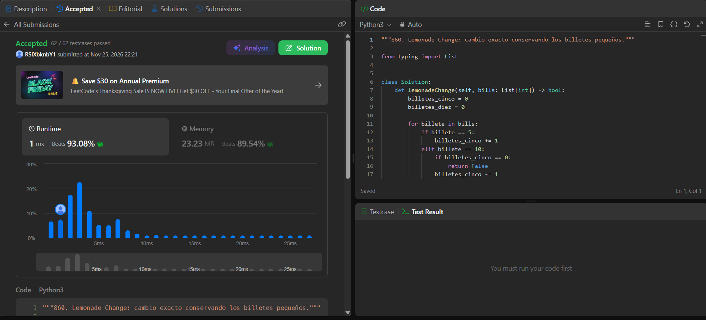
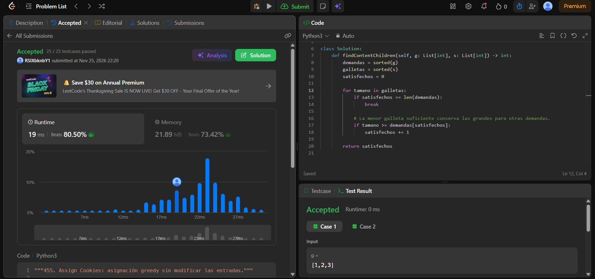

# Tarea 1 — Algoritmos greedy

**Jesid Alexander López Álvarez · 2026-2**

Enunciado: [Tarea 1 del curso](https://github.com/alejandrosalgar/Introduccion-programacion-cientifica/blob/main/tarea1.md).

## 860. Lemonade Change

- [Problema](https://leetcode.com/problems/lemonade-change/).
- [Solución Python](lemonade_change.py): clase `Solution`, método `lemonadeChange`.
- Criterio greedy: para devolver 15, se prefiere un billete de 10 y uno de 5
  antes que tres de 5. Se conservan billetes de 5, necesarios para atender
  también a quienes pagan con 10.
- Invariante: los contadores representan únicamente los billetes recibidos y
  todavía disponibles. Si ninguna combinación permite dar el cambio al cliente
  actual, no es posible atender la fila completa en su orden original.
- No es necesario guardar billetes de 20: no sirven para dar cambio de 5 o 15.
- Tiempo: **O(n)**, una pasada por la fila.
- Espacio auxiliar: **O(1)**, dos contadores.



## 455. Assign Cookies

- [Problema](https://leetcode.com/problems/assign-cookies/).
- [Solución Python](assign_cookies.py): clase `Solution`, método `findContentChildren`.
- Criterio greedy: ordenar demandas y galletas y entregar la galleta más pequeña
  que satisfaga al siguiente niño menos exigente.
- Justificación: una galleta insuficiente para el niño menos exigente tampoco
  sirve a los restantes. Usar la menor suficiente conserva las grandes para
  demandas posteriores; intercambiarla por una grande no mejora la cantidad
  total de niños satisfechos.
- Las listas recibidas no se modifican: se ordenan copias.
- Tiempo: **O(n log n + m log m)**, dominado por las dos ordenaciones.
- Espacio auxiliar: **O(n + m)** por las copias ordenadas.



## Verificación local

Desde la raíz del repositorio:

```powershell
python -m unittest discover -s Tarea1/Jesid -p "test_*.py" -v
```

Se comprueban ejemplos, casos límite, entradas no modificadas y tamaños máximos.
Además, se contrastan **14.641 asignaciones de galletas** y **9.841 secuencias
de pagos** con búsquedas exhaustivas independientes para entradas pequeñas.

## Estado de entrega

Ambos envíos obtuvieron **Accepted** en LeetCode. Las capturas originales,
sin recortes, incluyen el resultado del Submit, los casos aprobados, el usuario
y las mediciones que mostró la plataforma:

| Problema | Casos aprobados | Tiempo | Memoria |
| --- | ---: | ---: | ---: |
| 860. Lemonade Change | 62/62 | 1 ms | 23,23 MB |
| 455. Assign Cookies | 25/25 | 19 ms | 21,89 MB |

Las soluciones, pruebas y evidencias están reunidas en esta carpeta. Según el
enunciado, la entrega de Tarea 1 debe publicarse en el repositorio individual.
